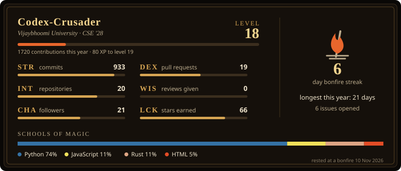
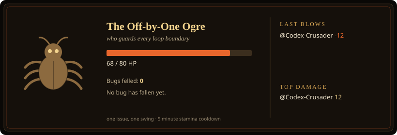

**Recruiter quick save.** Third-year CSE student at Vijaybhoomi University (class of 2028), he/him. I build local-first software, ML systems and security tools, and I write up what broke along the way. Top 17 of 4,000 at the National Entrepreneurship Challenge 2025 (E-Cell IIT Bombay). ISC² Certified in Cybersecurity.

  
  
  
  

  

## ⚔️ A bug blocks the path

One issue, one swing. Pick an attack below and press **Create**. A GitHub Action rolls your damage, replies, closes the issue and updates this card. Give it a few minutes, then refresh. Land the final blow and your name goes on the card.

  

  
  

## 📜 About me

Third-year CS student who builds things because they seem interesting, not because there's a roadmap. No grand mission statement, just a bias for action and a high tolerance for things being broken.

Soulsborne player who genuinely enjoys dying repeatedly and calling it a hobby (hence the boss fight above). Would probably debug faster with a Samoyed next to me. Runs best between 11 PM and 4 AM, same as my code.

Gets hyper-fixated on problems until they stop existing. This works out about 70% of the time.

## 🏺 Hall of Relics

My best work, ranked by stars. Rarity updates itself every day.

<!-- REPOS_START -->
| Relic | Rarity | What it does | Links |
|---|---|---|---|
| **Digital Footprint Cleaner** |  | Finds and erases your digital footprint across public websites. Flask, fully automated. | [code](https://github.com/Codex-Crusader/digital-footprint-cleaner) |
| **Rice-sauce-hair** |  | Arch + Hyprland desktop with a local AI companion that plans, acts safely and hands hard tasks to Claude Code. | [code](https://github.com/Codex-Crusader/Rice-sauce-hair) · [post](https://codex-crusader.github.io/writing/local-ai-desktop-companion-hyprland/) |
| **AZLite** |  | AlphaZero-style chess engine in PyTorch that learns only from self-play. | [code](https://github.com/Codex-Crusader/azlite_type_chess_bot) · [post](https://codex-crusader.github.io/writing/alphazero-chess-engine-python/) |
| **bruhswer** |  | Hardened Edge with fail-closed startup and download quarantine. Says NOT ENFORCEABLE when it cannot. | [code](https://github.com/Codex-Crusader/bruhswer-the-homebrew-pseudo-browser) · [post](https://codex-crusader.github.io/writing/browser-hardening/) |
| **Unstrung** |  | Local AI characters that remember you. Rust, Tauri and React; nothing leaves your machine. | [code](https://github.com/Codex-Crusader/unstrung) · [live](https://codex-crusader.github.io/unstrung/) · [post](https://codex-crusader.github.io/writing/rust-local-ai-memory-management/) |
| **NCAA Predictor** |  | NCAA predictor: ESPN data, six models, data leakage removed, live dashboard. | [code](https://github.com/Codex-Crusader/Uni-basketball-ETL-pipeline) · [live](https://uni-basketball-etl-pipeline.onrender.com/) · [post](https://codex-crusader.github.io/writing/data-leakage-basketball-model/) |
| **T-Rustable** |  | Offline, mod-first PDF editor for Linux and Windows. Rust and Svelte. | [code](https://github.com/Codex-Crusader/t-rustable) · [post](https://codex-crusader.github.io/writing/i-hate-rust/) |
| **Visitor Access Study** |  | UX study of campus visitor entry: interviews, card sorts, tree tests and a new information architecture. | [code](https://github.com/Codex-Crusader/visitor-access-project) · [post](https://codex-crusader.github.io/writing/campus-visitor-access-ux-study/) |
<!-- REPOS_END -->

<!-- RECENT_START -->
**Recently forged:** [unstrung](https://github.com/Codex-Crusader/unstrung) (2026-11-10) · [visitor-access-project](https://github.com/Codex-Crusader/visitor-access-project) (2026-11-08) · [Rice-sauce-hair](https://github.com/Codex-Crusader/Rice-sauce-hair) (2026-10-28)
<!-- RECENT_END -->

All of it lives [here](https://github.com/Codex-Crusader?tab=repositories&sort=stargazers).

## 🔮 Spells known

  

| School | What I actually use it for |
|---|---|
| **Languages** | Python, Rust, TypeScript, JavaScript, SQL |
| **Desktop and web** | Tauri, React, Svelte, Vite, Flask, Next.js, SQLite |
| **Machine learning** | Deep learning (PyTorch), reinforcement learning from self-play, scikit-learn, statistical testing, local LLMs with Ollama |
| **Data** | Data pipelines and ETL, data leakage hunting, data visualization, MLOps |
| **Systems and security** | Linux (Arch + Hyprland), Bash, PowerShell, containers, CI/CD with GitHub Actions, browser hardening, privacy by default |
| **Research** | UX research: interviews, card sorts, tree tests, information architecture |

## 🏆 Trophies

- **Top 17 of 4,000**, National Entrepreneurship Challenge 2025, E-Cell IIT Bombay (a six-month national competition)
- **Shortlisted**, ISRO IRoC-U 2025, from 2,000+ teams with team VSST
- **Youth panelist**, MANTHAN: Youth Voices, on AI and digital literacy
- **Certifications:** ISC² Certified in Cybersecurity (2024), Google Cloud Cybersecurity (2025), IBM Data Engineering (2025)
- **Volunteer of the Month**, DBM India (2025)

## 🗺️ Side quests

- 🏃 **Co-Head, Kanyathon** (Mumbai Division): women-focused charity marathon; managed 30 volunteers, 100+ CSR cold outreaches, full sponsorship pipeline
- 🛡️ **Co-founder of PulseEngine**, an open-source developer community
- 🎙️ Working on a podcast exploring AI's impact on Indian CS students, focused on the tensions, not the hype
- 💼 Freelancing on Fiverr and privately: data analytics, startup grunt work, and whatever interesting problems people need solved
- 🔧 Somewhere in the open-source world, making small things slightly less broken

**Current quest:** exploring AI/ML where the data is messy and the stakes are real, and reading everything I can about developer tooling, open-source sustainability and labor economics in tech.

<picture>
  <source media="(prefers-color-scheme: dark)" srcset="https://raw.githubusercontent.com/Codex-Crusader/Codex-Crusader/output/github-contribution-grid-snake-dark.svg"/>
  
</picture>

  
  
  
  

  Code is for humans first, machines second. Building things that matter, one commit at a time. 
  Bonfire lit. Your progress has been saved.

